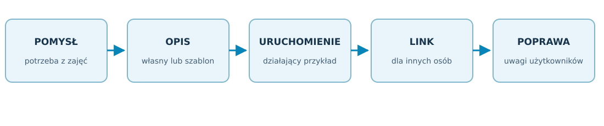
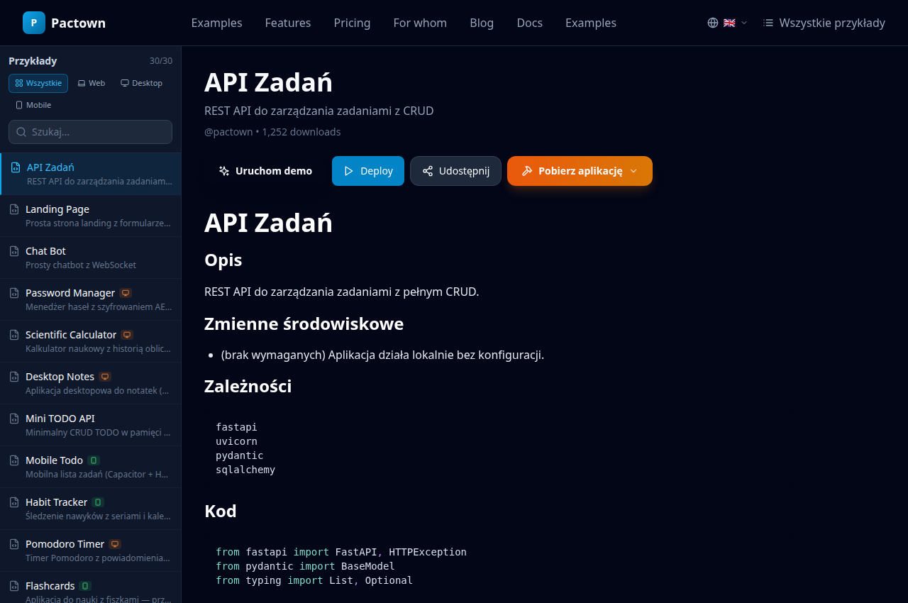

---
{
  "schema": "wellmanifest.docs/document/v1",
  "id": "pactown-uksw-pl",
  "kind": "information",
  "version": 1,
  "title": "Pactown — od pomysłu do działającej usługi na uczelni",
  "status": "implemented",
  "owner": "pactown-com/pactown",
  "scope": "repository",
  "created": "2026-10-13",
  "updated": "2026-10-13",
  "review_after": "2026-11-13",
  "source_revision": "c288260fbabca5fcbef6f445f10b41d52bef864b",
  "affected_repositories": ["pactown-com/pactown", "pactown-com/pactown-com"],
  "evidence": ["repo://pactown-com/pactown/reports/uksw-presentation-evidence.json", "https://wmcm.uksw.edu.pl/kandydaci/kontakt/"]
}
---

# Pactown — od pomysłu do działającej usługi

<!-- docs:section purpose -->
## Pomysł, który można sprawdzić w praktyce

**Autorzy projektu Pactown: Tomasz Sapletta i Bartłomiej Michalak.**

Pactown powstaje po to, aby studenci, pracownicy naukowi i pozostali pracownicy
uczelni mogli łatwiej zamieniać własne pomysły w działające narzędzia cyfrowe.
Punktem wyjścia może być potrzeba z zajęć, zadanie badawcze, mały proces
organizacyjny albo pomysł na udostępnienie danych i usług innym osobom.

Zamiast rozpoczynać od zamawiania rozbudowanego systemu, można przygotować
mały prototyp, uruchomić go w dostępnej infrastrukturze i sprawdzić z użytkownikami,
czy rzeczywiście rozwiązuje problem. Działającą aplikację lub usługę internetową
można pokazać przez link, wykorzystać na ćwiczeniach i rozwijać po zebraniu uwag.

> Student lub pracownik powinien móc zacząć od pytania „co chcę umożliwić
> innym?”, a następnie pokazać działający przykład swojego rozwiązania.

### Co zmienia Pactown

Rozwiązanie ogranicza liczbę czynności potrzebnych do przygotowania środowiska,
uruchomienia programu i udostępnienia go innym. Łączy opis projektu, jego kod
i sposób wykonania. Gotowe przykłady oraz opcjonalne wsparcie AI mogą pomóc
w przygotowaniu pierwszej wersji.

W udostępnionym i przygotowanym środowisku nie trzeba każdorazowo zaczynać od
osobnego serwera, długiej specyfikacji zamówienia i wieloetapowych rozmów o
technologii. Specjaliści IT mogą przygotować wspólne ramy działania, a użytkownicy
samodzielniej realizować kolejne małe pomysły w tych ramach.

Projekt łączy platformę dostępną przez przeglądarkę z silnikiem uruchamiającym
opisane aplikacje. Dla odbiorcy jest to **jeden Pactown**: miejsce, w którym
pomysł można opisać, wykonać, udostępnić i poprawić.

<!-- docs:section scope -->
## Co można tworzyć i udostępniać

Pactown jest przeznaczony do różnych rodzajów aplikacji i usług. Ten sam pomysł
może zacząć się od prostego formularza, a później otrzymać interfejs dla innego
programu, aplikację na komputer lub wersję mobilną.

| Rodzaj rozwiązania | Przykład zastosowania na uczelni |
|---|---|
| **Aplikacja webowa** | formularz do ćwiczenia, panel wyników, narzędzie do analizy tabel, strona projektu badawczego |
| **Aplikacja desktopowa** | narzędzie pracujące na komputerze z lokalnymi plikami, pomocniczy program laboratoryjny lub demonstrator |
| **Aplikacja mobilna** | interfejs zadania dostępny na telefonie, notatnik ćwiczenia lub prototyp aplikacji terenowej |
| **API i endpointy** | adres, pod którym inny program może pobrać dane, wysłać wynik albo wywołać przygotowaną funkcję |
| **Samodzielny komponent** | usługa przetwarzająca plik, sprawdzająca format danych, obliczająca wskaźnik lub przygotowująca raport |

### Udostępnianie części większego rozwiązania

Nie trzeba budować całego systemu, aby uzyskać użyteczny rezultat. Można
udostępnić tylko zbiór danych do ćwiczenia, funkcję przetwarzania wyników,
demonstracyjny interfejs aparatury lub pojedynczą usługę potrzebną innemu zespołowi.
Pozostałe osoby korzystają z przygotowanego elementu przez stronę lub API.

„Autonomiczny komponent” oznacza tu niewielkie narzędzie wykonujące ustaloną
czynność, na przykład przyjęcie pliku i przygotowanie podsumowania. Można
łączyć takie elementy w większy proces, zamiast za każdym razem tworzyć
wszystko od początku.

### Rzeczywisty zakres możliwości

Uruchamianie usług webowych i API zostało sprawdzone na działających przykładach.
Kod projektu zawiera również mechanizmy budowania aplikacji desktopowych
i mobilnych. Ich przygotowanie zależy od wybranego frameworka, dostępnych
narzędzi i platformy docelowej. Pactown ogranicza bariery techniczne, ale
złożoność konkretnej aplikacji nadal zależy od jej funkcji i integracji.

<!-- docs:section evidence -->
## Od opisu do linku dla innych osób

1. **Określenie potrzeby.** Prowadzący lub student wybiera mały problem do rozwiązania.
2. **Opis i pierwsza wersja.** Powstaje opis projektu, kod lub adaptacja gotowego przykładu; AI może pomóc w przygotowaniu propozycji.
3. **Uruchomienie.** Pactown przygotowuje projekt do wykonania i pokazuje wynik lub diagnostykę.
4. **Udostępnienie.** Uczestnicy dostają link do aplikacji albo adres usługi API.
5. **Ocena i poprawa.** Zespół sprawdza przydatność rozwiązania i zmienia je na podstawie rzeczywistego użycia.

Przykład pokazuje istniejący interfejs platformy. Zastosowania opisane dalej
są propozycjami dla Collegium Medicum, a nie deklaracją już wdrożonych
rozwiązań UKSW. Gotowy prototyp jest punktem wyjścia do oceny potrzeb i dalszego rozwoju.

<!-- docs:section content -->
## Korzyści dla uczelni i jej społeczności

### Korzyści dla różnych grup

| Odbiorca | Możliwa korzyść |
|---|---|
| **Studenci** | więcej samodzielności; możliwość pokazania działającego rezultatu zadania; praktyczna nauka pracy z danymi, usługami i narzędziami AI |
| **Prowadzący zajęcia** | szybkie przygotowanie narzędzia do konkretnego ćwiczenia; wspólny przykład dla grupy; łatwiejsze porównanie i ponowne wykorzystanie prac |
| **Pracownicy naukowi** | sprawdzenie pomysłu badawczego przed większą inwestycją; udostępnianie metod analizy i danych demonstracyjnych; łatwiejsza współpraca między zespołami |
| **Pracownicy organizacyjni** | prototypy małych formularzy i automatyzacji dopasowanych do rzeczywistego przebiegu pracy |
| **Zespół IT** | mniej powtarzalnych próśb o środowiska dla drobnych eksperymentów; możliwość skupienia się na wspólnej infrastrukturze i trwałych wdrożeniach |
| **Władze uczelni i wydziału** | lepsza ocena potrzeb przed wydatkiem; widoczne rezultaty pilotaży; rozwijanie kompetencji cyfrowych i współpracy interdyscyplinarnej |

### Przykłady dla Collegium Medicum

**Ćwiczenia z biostatystyki.** Prowadzący udostępnia syntetyczny zbiór danych,
a grupa przygotowuje prostą aplikację obliczającą statystyki i prezentującą
wykresy. Wynik zadania jest działającym narzędziem, które można porównać
z rozwiązaniami innych zespołów.

**Scenariusze dydaktyczne.** Formularz prowadzi przez przygotowany przypadek
ćwiczeniowy i zapisuje wybory uczestnika. Prowadzący może omawiać przebieg
zadania i szybko zmieniać treść scenariusza między zajęciami.

**Praca laboratoryjna.** Prototyp przyjmuje plik z przykładowymi wynikami,
sprawdza jego strukturę i przygotowuje zestawienie. Zespół ocenia przydatność
procesu na danych demonstracyjnych przed podłączeniem rzeczywistej aparatury.

**Udostępnienie metody badawczej.** Autor obliczenia przygotowuje API zwracające
wynik dla danych wejściowych. Inny zespół może korzystać z tej metody bez
przenoszenia całego programu do własnego środowiska.

**Projekt koła naukowego.** Studenci budują demonstrator narzędzia, udostępniają
go opiekunowi i zbierają uwagi. Działająca wersja może wspierać prezentację
wyników pracy lub doprecyzowanie założeń kolejnego etapu projektu.

**Wsparcie organizacji ćwiczeń.** Pracownik przygotowuje próbny formularz
zgłoszeń, zbierania potrzeb lub wyboru tematu zadania. Zespół testuje przebieg
pracy, zanim zdecyduje o połączeniu go z oficjalnym systemem uczelni.

### Mniej powtarzania tej samej pracy

Użyteczny przykład można zachować jako szablon. Kolejny prowadzący zmienia
treść ćwiczenia lub dane, zamiast ponownie przygotowywać całe środowisko.
W ten sposób może powstać wydziałowy katalog małych narzędzi: formularzy,
analiz, demonstracyjnych API i komponentów do projektów studenckich.

Zapisanie opisu, kodu i sposobu uruchomienia w jednym projekcie ułatwia
przekazanie narzędzia innej osobie oraz odtworzenie wersji użytej na zajęciach.
Pomaga też zachować rezultaty po zakończeniu semestru lub zmianie składu zespołu.

### Najpierw sprawdzenie potrzeby, później decyzja o inwestycji

Pactown może ograniczyć sytuacje, w których jedynym sposobem sprawdzenia
małego pomysłu wydaje się zamówienie dużego systemu. **Prototyp można przygotować
w już udostępnionym środowisku, pokazać użytkownikom i dopiero wtedy określić,
co rzeczywiście warto rozwijać.**

Daje to uczelni konkretniejszą podstawę do decyzji: wiadomo, kto korzysta
z narzędzia, czego potrzebuje i jakie funkcje są ważne. Pomysły nietrafione
można zakończyć po małym eksperymencie, a udane przekazać do dalszego wdrożenia
z lepiej rozpoznanymi wymaganiami.

Oszczędność polega na ograniczeniu kosztu pierwszego sprawdzenia i niepotrzebnej
pracy. Nie oznacza automatycznie bezpłatnego utrzymania ani pomijania zasad
zakupowych uczelni. Nowa infrastruktura, płatne usługi i wdrożenia trwałe
pozostają przedmiotem odpowiednich decyzji organizacyjnych.

<!-- docs:section limitations -->
## Warunki dobrego wykorzystania

**Wspólne środowisko na start.** Uczelnia lub operator udostępnia środowisko
z określonym dostępem i zasobami. Dzięki temu uczestnik zajęć może koncentrować
się na narzędziu, a nie na administrowaniu serwerem. Ograniczenie potrzeby
każdorazowej konsultacji technicznej zakłada wcześniejsze przygotowanie tych ram.

**Zakres danych odpowiedni do ćwiczenia.** Pilotaż można prowadzić na danych
syntetycznych i materiałach demonstracyjnych. Dostęp do danych pacjentów,
danych osobowych i systemów klinicznych wymaga osobnych uzgodnień. Prototyp
dydaktyczny nie staje się przez sam fakt uruchomienia narzędziem diagnostycznym.

**Jasny sposób udostępnienia.** Nie każda aplikacja musi być publiczna dla
całego internetu. Dla konkretnego projektu trzeba ustalić odbiorców, kontrolę
dostępu i zakres publikowanych danych. Uruchamianie własnego kodu oraz
propozycji AI wymaga sprawdzenia działania w wybranym środowisku.

**Opiekun trwałego narzędzia.** Jeśli prototyp ma pozostać w użyciu, potrzebuje
osoby odpowiedzialnej za aktualizacje, dostęp, dane i utrzymanie. Pactown
ułatwia pierwszy krok; dalsze wymagania wynikają z znaczenia danej usługi.

### Stan projektu i podstawa materiału

Projekt jest rozwijany. W audycie technicznym z 13 października 2026 wybrane
testy biblioteki dały 115 wyników PASS i 2 pominięcia, a testy platformy
67 PASS dla backendu i 28 PASS dla interfejsu. Sprawdzono też lokalną
demonstrację dwóch usług i publiczne strony. Te kontrole nie są oceną
skuteczności dydaktycznej ani potwierdzeniem wdrożenia na UKSW.

Dane odbiorcy potwierdza
[oficjalna strona kontaktowa wydziału](https://wmcm.uksw.edu.pl/kandydaci/kontakt/).
Opis możliwości opiera się na kodzie obu komponentów Pactown i ich dokumentacji;
proponowane zastosowania oraz korzyści są scenariuszami do sprawdzenia w pilotażu.

<!-- docs:section next_actions -->
## Propozycja pilotażu na uczelni

Najlepszym pierwszym krokiem może być **mały pilotaż w jednej grupie zajęciowej
lub jednym zespole badawczym**, z kilkoma dobrze określonymi zadaniami.
Poniższe cztery tygodnie to proponowany przebieg, wymagający uzgodnienia z uczelnią.

| Etap | Działanie | Rezultat |
|---|---|---|
| **Tydzień 1** | wybór uczestników i potrzeb; udostępnienie środowiska oraz przykładowych danych | wspólny punkt startu i jasny zakres pilotażu |
| **Tydzień 2** | wykonanie formularza, prostej analizy i demonstracyjnego API | pierwsze działające narzędzia do pokazania grupie |
| **Tydzień 3** | użycie na ćwiczeniu lub w kontrolowanym zadaniu zespołu; zebranie uwag | informacja o przydatności, trudnościach i potrzebnych poprawkach |
| **Tydzień 4** | ocena rezultatów i zapisanie dobrych przykładów jako szablonów | decyzja o dalszym rozwoju i materiał dla kolejnych uczestników |

### Po czym poznać, że rozwiązanie pomaga

Warto mierzyć czas od zgłoszenia pomysłu do pierwszego działającego przykładu,
liczbę zadań wykonanych samodzielnie przez uczestników i ilość potrzebnego
wsparcia. Równie ważne są: możliwość ponownego uruchomienia projektu, wykorzystanie
szablonu przez inną osobę i ocena przydatności przez prowadzącego.

Korzyści i oszczędności można wtedy ocenić na podstawie wyników pilotażu.

> Pactown daje uczelni możliwość zaczynania od małych, działających rozwiązań.
> Wiedza i pomysł studenta lub pracownika mogą szybciej stać się narzędziem,
> z którego korzystają inni.

### Materiały do dalszej rozmowy

- [Pactown — publiczna platforma i przykłady](https://pactown.com).
- [Projekt Pactown — biblioteka i narzędzia wykonawcze](https://github.com/pactown-com/pactown).
- [Dokumentacja techniczna rozwiązania](solution-pl.md) — materiał pomocniczy dla zespołu wdrożeniowego.
- [Podstawa weryfikacji tego opracowania](../../reports/uksw-presentation-evidence.json).
