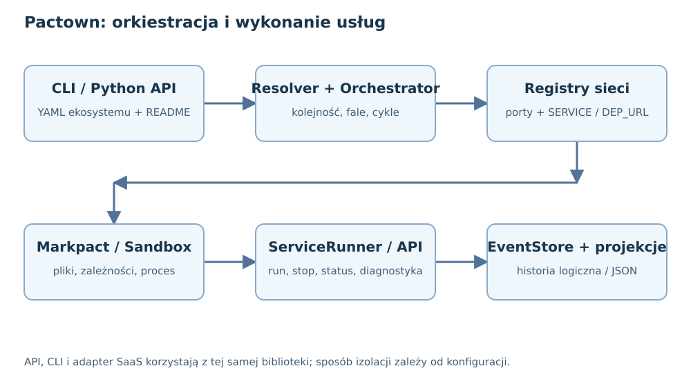
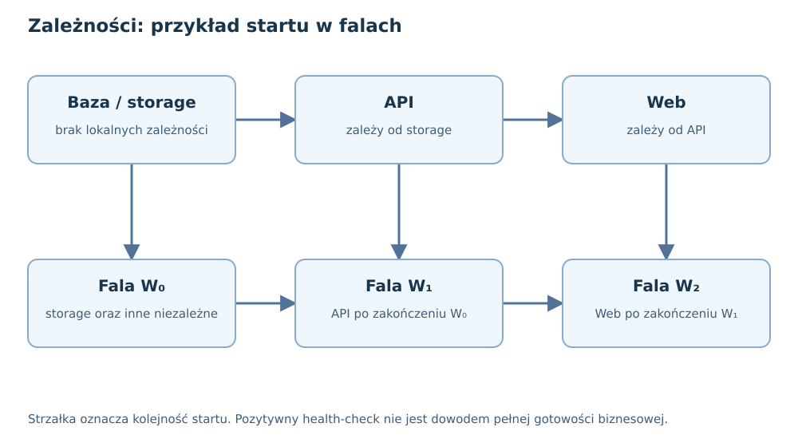
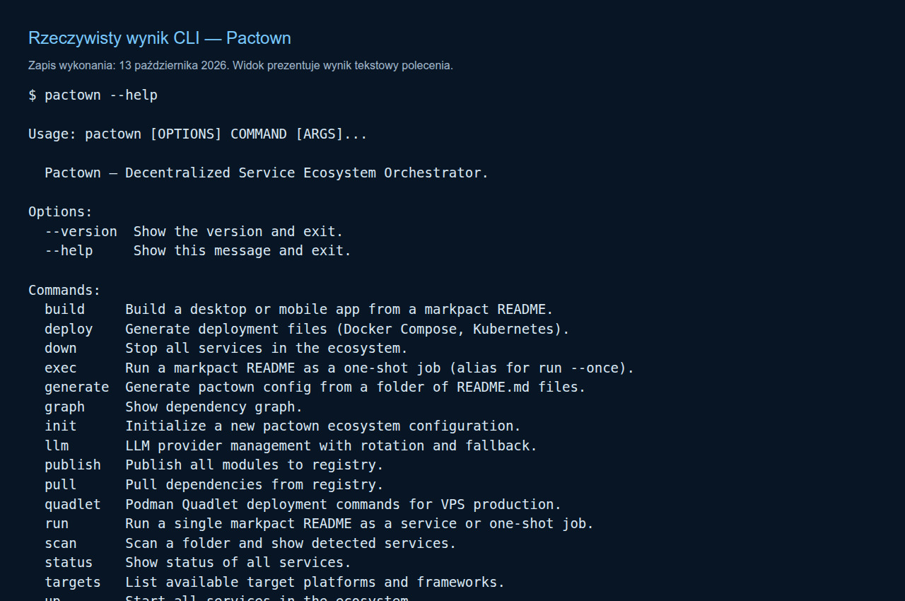
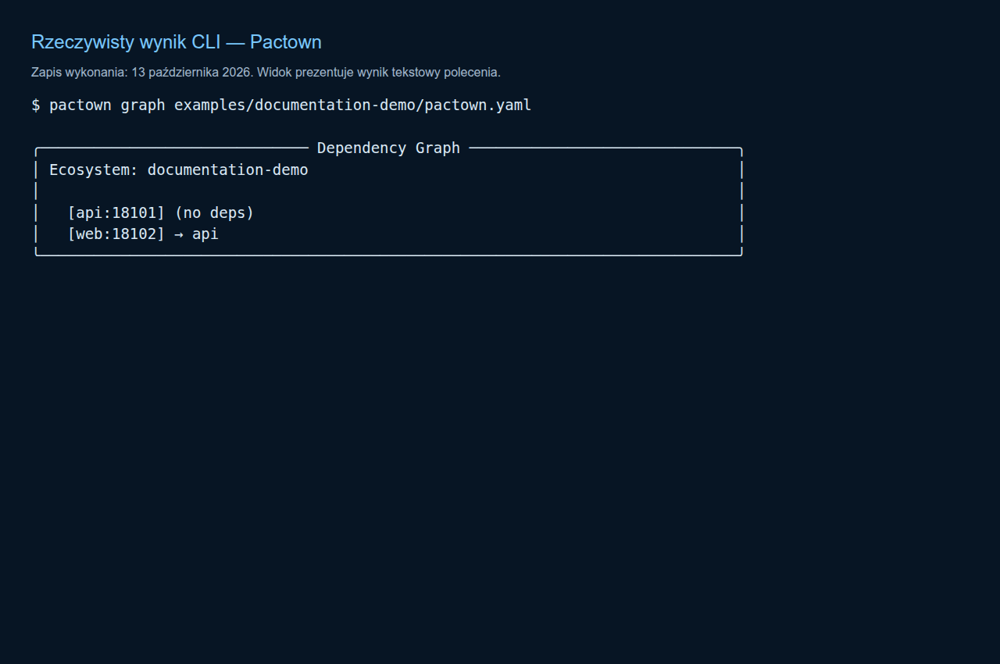
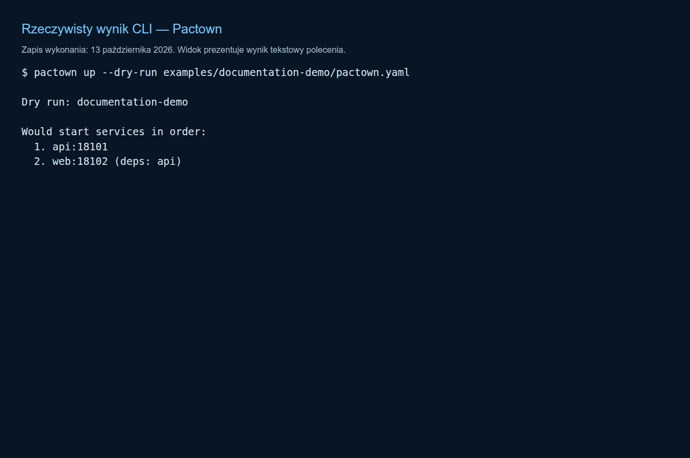
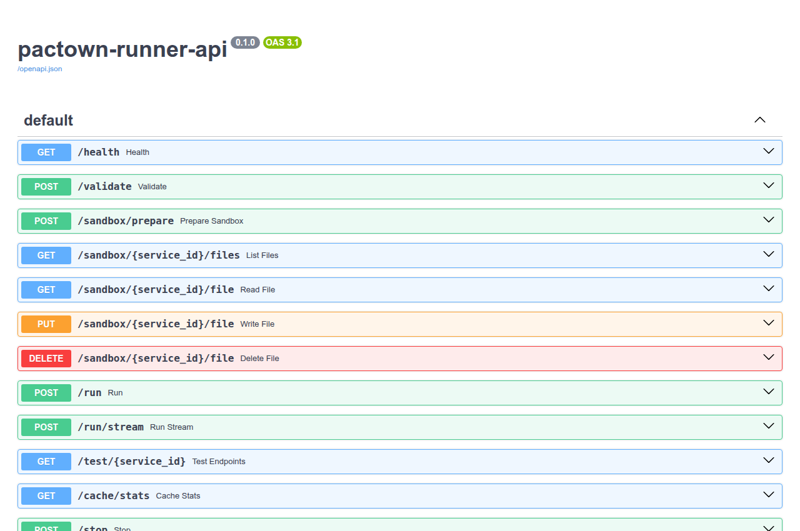

---
{
  "schema": "wellmanifest.docs/document/v1",
  "id": "solution-pl",
  "kind": "information",
  "version": 1,
  "title": "Pactown — dokumentacja rozwiązania",
  "status": "implemented",
  "owner": "pactown-com/pactown",
  "scope": "repository",
  "created": "2026-10-13",
  "updated": "2026-10-13",
  "review_after": "2026-11-13",
  "source_revision": "67fae10b7492886e29627cfac341b8adeeb1ac73",
  "affected_repositories": [
    "pactown-com/pactown",
    "pactown-com/pactown-com"
  ],
  "evidence": [
    "repo://pactown-com/pactown/reports/documentation-verification.json",
    "repo://pactown-com/pactown/reports/local-demo-verification.json"
  ]
}
---

# Pactown — dokumentacja rozwiązania

<!-- docs:section purpose -->
## Cel i streszczenie

Pactown jest biblioteką Python oraz zestawem narzędzi do składania i uruchamiania
usług opisanych w Markdown. README usługi zawiera pliki aplikacji, zależności
i polecenie startu w blokach `markpact:*`; konfiguracja YAML określa usługi,
ich zależności i parametry środowiska. Rozwiązanie pomaga ograniczyć rozbieżność
między przykładem w dokumentacji a kodem, który czytelnik może uruchomić.

Przykładowym odbiorcą jest zespół przygotowujący demonstrację API i interfejsu
webowego, operator środowiska usług albo autor platformy udostępniającej
wykonywanie projektów. Biblioteka jest silnikiem używanym przez platformę
[Pactown.com](https://github.com/pactown-com/pactown-com). Konto użytkownika,
płatności, edytor przeglądarkowy i publiczna witryna należą do tej platformy.

Dokument prowadzi od modelu danych i algorytmu zależności przez działający
przykład do ograniczeń wdrożeniowych. Zawiera prawdziwe wyniki CLI, zrzut
lokalnego API oraz tabelę wykonanych kontroli. Wzory opisują istniejące mechanizmy;
nie deklarują gwarantowanego czasu startu ani bezpieczeństwa wykonywania dowolnego kodu.

<!-- docs:section scope -->
## Zakres i wersje

Podstawą audytu jest kod `67fae10b7492886e29627cfac341b8adeeb1ac73` oraz niewielka
poprawka wyświetlania grafu CLI opisana dalej. PDF wiąże odnośniki do plików
z konkretnym lokalnym commitem dostarczonych źródeł, zapisanym w jego metadanych.
Nie obejmuje niezacommitowanych zmian z głównego checkoutu użytkownika.

| Element | Stan odczytany ze źródeł |
|---|---|
| Pakiet `pactown` | `0.1.173`, status Alpha w `pyproject.toml` |
| Python deklarowany przez pakiet | `>=3.10` |
| Python użyty do weryfikacji | 3.12.13, Linux |
| Markpact w środowisku testowym | `0.1.42`; deklaracja pakietu: `>=0.1.18` |
| Biblioteka używana przez backend Pactown.com | odrębne przypięcie `pactown==0.1.164` |
| Interfejsy | `pactown`, `pactown-registry`, `pactown-runner-api`, `pactown-quadlet-api` |

Nagłówek historycznego README „New in v0.4.0” nie wyznacza bieżącej wersji
pakietu. Wersję należy odczytać z [metadanych](../../pyproject.toml) i
[modułu pakietu](../../src/pactown/__init__.py). Kod importuje `datetime.UTC`,
dostępne od Python 3.11, więc sama deklaracja `>=3.10` nie dowodzi działającego
wsparcia 3.10. Ten dokument podaje sprawdzone środowisko 3.12.

Metadane pakietu wskazują autora projektu „Tom Sapletta”. Licencję oprogramowania
określa [LICENSE](../../LICENSE), Apache-2.0. Dokumentacja nie rozszerza praw
do zależności ani nie wprowadza nowych współwłaścicieli kodu.

<!-- docs:section evidence -->
## Weryfikacja i dowody

| Kontrola | Wynik i granica wniosku |
|---|---|
| Wybrane istniejące testy źródeł | 115 PASS, 2 SKIP; konfiguracja, resolver, sieć, domeny, bloki Markpact, platformy, bezpieczeństwo i IaC |
| Pierwszy pominięty test | test importuje nieistniejący eksport `runner_api.app`; fabryka API istnieje i została uruchomiona osobno |
| Drugi pominięty test | audyt zależności pomija lokalny pakiet; brak wyniku audytu podatności |
| Demonstracja z dwoma procesami | API i Web zwróciły HTTP 200; Web dostał rzeczywisty adres API w `API_URL` |
| Sprzątanie demonstracji | oba procesy zatrzymano przez `stop_all()` |
| CLI | `--help`, `validate`, `graph`, `up --dry-run` wykonane na dołączonym przykładzie |
| Runner API | rzeczywiste lokalne `/docs` zwróciło HTTP 200 |

Zakres testów obejmuje dziesięć plików testowych, nie pełny zestaw testów projektu.
Maszynowy [raport weryfikacji](../../reports/documentation-verification.json)
zapisuje zestaw, liczby i wersje zależności, a [wynik demonstracji](../../reports/local-demo-verification.json)
potwierdza wykonanie. Wyniki nie są niezależnym zatwierdzeniem PR ani potwierdzeniem
wdrożenia wersji biblioteki na zewnętrznym serwerze.

Podczas audytu polecenie `graph` gubiło nazwy usług: Rich interpretował nawiasy
kwadratowe jako znaczniki formatowania. Poprawka używa `Text` do literalnego
wyświetlenia grafu. Ponowne wykonanie pokazało `[api:18101]` oraz `[web:18102]`.
Nie zmieniono rozwiązywania zależności.

<!-- docs:section content -->
## Architektura, działanie i uruchomienie

### Warstwy rozwiązania



| Warstwa | Odpowiedzialność i źródło |
|---|---|
| Konfiguracja | modele ekosystemu, usług, cache i rejestru; [config.py](../../src/pactown/config.py) |
| Zależności | graf, kolejność startu, wykrywanie cykli; [resolver.py](../../src/pactown/resolver.py) |
| Orkiestracja | start sekwencyjny lub falami, stop, status, health; [orchestrator.py](../../src/pactown/orchestrator.py) |
| Sieć | przydział portów i zmienne adresów usług; [network.py](../../src/pactown/network.py) |
| Wykonanie | parsowanie README, sandbox, proces i diagnostyka; [service_runner.py](../../src/pactown/service_runner.py), [sandbox_manager.py](../../src/pactown/sandbox_manager.py) |
| Runner HTTP | fabryka aplikacji FastAPI; [runner_api.py](../../src/pactown/runner_api.py) |
| Historia | zdarzenia, komendy, zapytania i projekcje; [events](../../src/pactown/events/store.py) |
| Eksport wdrożenia | Docker, Compose, Kubernetes, Ansible i Quadlet; [IaC](../../src/pactown/iac/spec.py) |

Konfiguracja nie jest gotową usługą. Orchestrator wczytuje deklaracje, ustala
kolejność, tworzy środowisko oraz uruchamia procesy. `ServiceRunner` udostępnia
wyższy poziom kontroli pojedynczego projektu, używany także przez adapter SaaS.
Rejestr artefaktów przechowuje opisy projektów, natomiast `ServiceRegistry`
przechowuje adresy działających usług. To dwa różne zadania.

### Markdown jako nośnik aplikacji

Parser bloków pochodzi z [Markpact](https://github.com/wronai/markpact).
[Rozszerzenie Pactown](../../src/pactown/markpact_blocks.py) obsługuje dodatkowo
deklaracje celu, rodzaju obciążenia i budowania. Typowe bloki to:

| Blok | Znaczenie |
|---|---|
| `markpact:file path=main.py` | zawartość pliku aplikacji |
| `markpact:deps` | zależności dla wskazanego języka |
| `markpact:run` | polecenie uruchomienia |
| `markpact:target` | cel web/desktop/mobile i wybrany framework |
| `markpact:build` | jawne polecenie budowania |
| `markpact:workload` | parametry obciążenia używane przez warstwę IaC |

README pozostaje dokumentem tekstowym, lecz polecenia w nim zapisane są kodem
wykonywalnym. Projekt należy traktować tak samo jak skrypt pobrany z repozytorium:
przed wykonaniem sprawdzić treść, zależności i sposób izolacji. Instalowanie
zależności może wymagać sieci i wykonywać skrypty instalacyjne.

### Algorytm zależności

Niech $V$ oznacza zbiór usług, a $D(v)$ — lokalne zależności usługi $v$.
Relacja $u\to v$ w poniższym diagramie oznacza „najpierw uruchom $u$, następnie $v$”.
Kolejność topologiczna $\pi$ spełnia:

$$u\in D(v)\quad\Rightarrow\quad\pi(u)<\pi(v).$$

Resolver utrzymuje liczbę niespełnionych zależności i kolejkę usług bez zależności.
Po pobraniu usługi zmniejsza odpowiednie liczniki pozostałych usług. Jeśli nie
uda się umieścić wszystkich usług w wyniku, zgłasza cykl. Zatrzymywanie odbywa
się w odwrotnej kolejności. Zależności spoza ekosystemu nie uczestniczą w lokalnym
sortowaniu; ich deklaracje i rejestr wymagają osobnej konfiguracji.



W trybie równoległym startują fale:

$$W_k=\{v\in V\setminus S_k:\ D(v)\subseteq S_k\},\qquad S_{k+1}=S_k\cup W_k.$$

W tym opisie $S_k$ zawiera usługi uruchomione w zakończonych falach. Pusta fala
przy niepustym zbiorze oczekujących oznacza nierozwiązaną zależność. Pula wątków
ogranicza liczbę jednoczesnych zadań parametrem `--workers`.

**Istotna granica implementacji:** `_wait_for_health()` zwraca `False` po upływie
czasu, ale wywołujący kod nie traktuje tego wyniku jako błędu całego startu.
Zakończenie fali nie gwarantuje zdrowia każdej usługi. `--no-health` pomija czekanie
całkowicie. Także `replicas` występuje w modelu konfiguracji, ale lokalny Orchestrator
nie uruchamia na tej podstawie wielu replik jednej usługi.

### Porty i wykrywanie usług

PortAllocator sprawdza dostępność portów i odrzuca porty poniżej 1024.
Przy zajętym porcie preferowanym może przydzielić inny. Rzeczywisty endpoint
trafia do rejestru sieci. Wstrzykiwane są m.in. `MARKPACT_PORT`, `SERVICE_NAME`,
`SERVICE_URL` oraz `API_URL`, `API_HOST`, `API_PORT` dla zależności nazwanej `api`.
Adres zależności należy czytać z tych zmiennych, zamiast składać go z pierwotnego YAML.

Sprawdzenie wolnego portu nie rezerwuje go nieodwołalnie do czasu startu procesu.
Ten lokalny mechanizm nie zastępuje planowania sieci klastra ani pełnego service mesh.

### Polityka limitów i token bucket

[RateLimiter](../../src/pactown/security/rate_limit.py) utrzymuje osobne wiadro
tokenów dla klucza użytkownika. Dla pojemności $B$, limitu $R$ żądań na minutę
i odstępu $\Delta t$ sekund od poprzedniej aktualizacji:

$$b_{now}=\min\left(B,\ b_{prev}+\frac{R}{60}\Delta t\right).$$

Operacja `consume()` może odjąć jeden token, gdy $b_{now}\ge1$.
Przy braku tokena przewidywany czas oczekiwania wynosi
$t_{wait}=(1-b_{now})/(R/60)$ dla dodatniego $R$.
Przykład: $B=10$, $R=60$ pozwala na początkowy burst 10 operacji; po wyczerpaniu
pełny token odnawia się po około sekundzie. To model z kodu, nie wynik benchmarku.

Stan limitera istnieje w pamięci jednego procesu. Instancje na kilku serwerach
nie współdzielą automatycznie licznika. Limity w profilach użytkowników opisują
politykę; ich obecność w modelu nie dowodzi wymuszenia wszystkich limitów przez system operacyjny.

### CQRS, zdarzenia i diagnostyka

Komendy reprezentują zapis, zapytania odczyt, a projekcje budują widok stanu
z historii zdarzeń. Ogólny model odtwarzania to:

$$state_n=apply(\ldots apply(apply(state_0,e_1),e_2)\ldots,e_n).$$

`EventStore.append()` nadaje numer sekwencji i powiadamia subskrybentów.
Blokada `asyncio.Lock` chroni współpracujące zadania tej instancji. Opcjonalna
trwałość polega na przepisaniu całego pliku JSON przez otwarcie go do zapisu.
Określenie „append-only” dotyczy publicznej operacji logicznej, nie fizycznego,
niezmienialnego dziennika. Kod nie zapewnia tu łańcucha hashy, blokady wielu procesów,
atomowej wymiany pliku ani gwarantowanego `fsync`.

Diagnostyka `nfo` może rejestrować argumenty wywołań, wyniki i wyjątki.
Przed udostępnieniem logów trzeba ograniczyć dane i sprawdzić redakcję sekretów.
Nie stwierdzono adopcji kanonicznego strumienia Wellmanifest Logs w tym audycie.

### Instalacja i pierwszy przykład

Sprawdzonym środowiskiem tej dokumentacji jest Linux i Python 3.12.
Instalacja z konkretnego checkoutu:

```bash
uv venv --python 3.12 .venv
uv pip install --python .venv/bin/python -e '.[dev]'
.venv/bin/pactown --version
.venv/bin/pactown --help
```

Zestaw `dev` zawiera więcej narzędzi niż potrzeba do samego uruchomienia usług.
W środowisku wykonawczym wystarczy instalacja `-e .`. Nie trzeba konfigurować
LLM dla dołączonego przykładu, który wykorzystuje wyłącznie standardową bibliotekę Python.

[Konfiguracja demonstracyjna](../../examples/documentation-demo/pactown.yaml)
opisuje API i Web, a [README API](../../examples/documentation-demo/api/README.md)
i [README Web](../../examples/documentation-demo/web/README.md) zawierają ich kod.

```yaml
name: documentation-demo
version: "1.0.0"
sandbox_root: .pactown-doc-demo
services:
  api:
    readme: api/README.md
    port: 18101
    health_check: /health
  web:
    readme: web/README.md
    port: 18102
    health_check: /health
    depends_on:
      - api
```

```bash
.venv/bin/pactown validate examples/documentation-demo/pactown.yaml
.venv/bin/pactown graph examples/documentation-demo/pactown.yaml
.venv/bin/pactown up --dry-run examples/documentation-demo/pactown.yaml
.venv/bin/pactown up examples/documentation-demo/pactown.yaml
```

W drugim terminalu sprawdź aktualnie przydzielone adresy. Gdy porty preferowane
są wolne, można wykonać `curl http://127.0.0.1:18101/health` oraz analogiczne
zapytanie na port 18102. Web zwraca pole `api_url` pobrane ze środowiska.
Przerwij `up` przez Ctrl+C, aby ta instancja Orchestratora zatrzymała własne procesy.
Odczyt statusu w nowej instancji CLI nie zastępuje kontroli procesu trzymanego w pamięci poprzedniej.

### Rzeczywiste wyniki i ekran API









Pochodzenie zrzutów, sumy SHA-256 i teksty CLI zapisano w
[manifeście](../media/screenshots/manifest.json). Zrzuty prezentacji CLI zachowują
tekst rzeczywistych wykonań; nie stanowią symulowanego panelu zarządzania.

### Budowanie, wdrożenie i LLM

`targets` pokazuje obsługiwane deklaracje platform. `build` deleguje pracę do
buildera web, desktop lub mobile. Skuteczność zależy od dostępnego SDK, narzędzi
systemowych, frameworka i docelowego systemu. Obecność buildera nie jest dowodem
przeprowadzonej kompilacji dla wszystkich platform.

Eksporty `deploy` i `quadlet` generują lub obsługują konfiguracje wdrożeniowe.
Wymagają weryfikacji portów, wolumenów, uprawnień i sekretów dla konkretnego hosta.
Nie wykonano w ramach tego audytu wdrożenia Kubernetes, instalacji na VPS ani kompilacji iOS/Android.

Integracja LLM jest opcjonalna i korzysta z osobnego mechanizmu dostawców.
Nie zmienia zasad sprawdzania i uruchamiania README. Odpowiedź modelu jest propozycją
kodu, którą należy zweryfikować. Koszt, jakość i dostępność dostawcy nie są właściwościami gwarantowanymi przez bibliotekę.

### Odtworzenie PDF

Potrzebne są Pandoc, Chrome lub Chromium oraz osobna zależność dokumentacyjna.
Budowanie nie uruchamia modeli ani usług aplikacji:

```bash
uv venv --python 3.12 .venv-docs
uv pip install --python .venv-docs/bin/python -r requirements-docs.txt
bash scripts/build_docs_pdf.sh
```

Wynik: `reports/pactown-dokumentacja.pdf`. Źródło:
`docs/information/solution-pl.md`; diagramy i zrzuty: `docs/media`.
Do przeglądu lokalnych zmian przed commitem można podać `--revision` istniejącego
commitu źródeł. Generator odrzuca odnośniki do plików nieobecnych w wskazanym commicie;
najpierw należy zacommitować źródła, następnie generować PDF.

### Źródła i materiały uzupełniające

Stan źródeł wewnętrznych: audyt 13 października 2026; wersje zależności z
raportu weryfikacji. Zewnętrzne materiały służą objaśnieniu mechanizmów,
nie potwierdzają jakości wdrożenia projektu.

1. [Konfiguracja Pactown](../CONFIGURATION.md) i [specyfikacja](../SPECIFICATION.md).
2. [Fast Start](../FAST_START.md), [model sieci](../NETWORK.md).
3. [User Isolation](../USER_ISOLATION.md), [polityka bezpieczeństwa](../SECURITY_POLICY.md).
4. [Generator konfiguracji](../GENERATOR.md), [wdrożenie](../DEPLOYMENT.md), [Quadlet](../QUADLET.md).
5. [Markpact — źródła parsera i wykonania](https://github.com/wronai/markpact).
6. [Python 3.12: środowiska venv](https://docs.python.org/3.12/library/venv.html).
7. [Python 3.12: datetime.UTC](https://docs.python.org/3.12/library/datetime.html#datetime.UTC).
8. [FastAPI: koncepcje wdrożeniowe](https://fastapi.tiangolo.com/deployment/concepts/).
9. [Podman: Quadlet i jednostki systemd](https://docs.podman.io/en/latest/markdown/podman-systemd.unit.5.html).
10. [Apache License 2.0](https://www.apache.org/licenses/LICENSE-2.0).

<!-- docs:section limitations -->
## Ograniczenia i interpretacja wyników

Izolowane katalogi i środowiska `venv` rozdzielają pliki i zależności Python.
Same nie blokują dostępu procesu do sieci, sekretów środowiska ani zasobów hosta.
Izolacja użytkowników Linux i kontenery mają dodatkowe wymagania; należy oceniać
konkretny tryb uruchomienia, uprawnienia, namespace i ograniczenia zasobów.

Nie wykonano pełnego audytu podatności, testu odporności na wrogą aplikację,
testów obciążeniowych ani pomiarów czasu Fast Start. Opisy „millisecond startup”
z historycznych materiałów nie są w tej dokumentacji aktualnym wynikiem pomiaru.
Nie zweryfikowano wszystkich systemów operacyjnych ani narzędzi deploymentu.

Zgodność formatu dokumentu, lokalne testy, niezależna ocena PR i działające
wdrożenie są odrębnymi dowodami. Ten dokument i jego raport nie przyznają
uprawnień publikacyjnych. Lokalna konfiguracja chronionej pętli publikacji nie
zawierała profilu `pactown-com/pactown` podczas audytu; nie deklarujemy automatycznego scalenia.

<!-- docs:section next_actions -->
## Dalsze prace

Przed udostępnieniem wykonywania niezaufanych README należy zweryfikować
granicę izolacji na docelowym hoście, ograniczyć sieć i sekrety oraz określić
retencję logów. Osobne zadania powinny ustalić minimalny działający Python,
politykę błędu health-check, semantykę `replicas` oraz trwałość historii zdarzeń.

Jeśli potrzebna jest publikacja źródeł przez lokalny Validator, najpierw trzeba
dodać profil w repozytorium właściciela polityki i równoważne chronione testy
w OneDev. Wdrożenie profilu wymaga niezależnego zatwierdzenia; generator PDF
i lokalny raport nie zastępują tej procedury.
